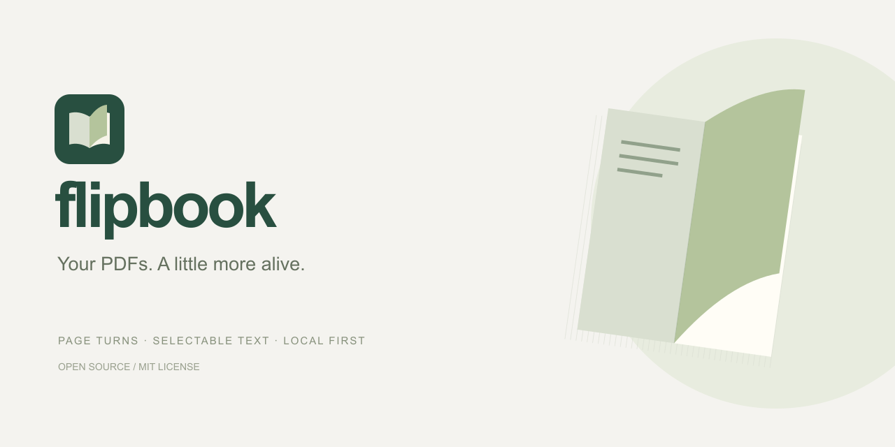

<p align="center"></p>
<h1 align="center">flipbook</h1>
<p align="center">Your PDFs. A little more alive.</p>
<p align="center">
  <a href="https://github.com/Pragith/flipbook/actions/workflows/ci.yml"></a>
  <a href="https://github.com/Pragith/flipbook/releases"></a>
  <a href="LICENSE"></a>
  
</p>



**flipbook is a local-first PDF magazine reader** with interactive page turns, selectable text and paper stacks you can browse. A one-screen welcome page lets you upload a PDF, drop a file or paste a public PDF URL. The reader keeps its controls small and gives the document the screen.

An open source product by [Vriksh Apps](https://vriksh.ca/?utm_source=flipbook&utm_medium=referral&utm_campaign=github_readme).

[Open Flipbook](https://flipbook.vriksh.ca) · [Download](https://github.com/Pragith/flipbook/releases) · [Getting started](#getting-started) · [Features](#features) · [Deployment](docs/DEPLOYMENT.md) · [Contributing](CONTRIBUTING.md) · [Changelog](CHANGELOG.md)

> **Status:** The hosted app is v0.3.0, an early 0.x release. It is a standalone viewer; accounts, document hosting and cloud annotation sync are outside this release. See [limitations](#limitations).

## Features

| Area               | Included                                                                                                                             |
| ------------------ | ------------------------------------------------------------------------------------------------------------------------------------ |
| Start              | Single-viewport welcome screen, prominent Upload PDF button, drag-and-drop, alternative PDF URL field                                |
| Reading            | Interactive mouse/touch folds, moving shadows, cover positioning, center-gutter shading                                              |
| Paper stacks       | Thickness changes with progress; hover across the depth to preview a number, click to jump                                           |
| Text               | Select and copy text directly from normal pages or the zoomed view                                                                   |
| Thumbnails         | Facing pairs, numeric labels without repeated “Page” text, outline only on the active spread, automatic scroll to the current spread |
| Search             | Search PDF text, read excerpts and jump to a matching spread                                                                         |
| Personal reading   | Per-document notes, bookmarks and saved position in local browser storage                                                            |
| Zoom               | Enlarge pages, scroll, select text and follow external PDF links                                                                     |
| Controls           | Title then page navigation at top left, search at far right, subtle icon-only bottom toolbar                                         |
| Sound              | Synthesized paper-turn sound, synchronized with turns, with a persistent mute preference                                             |
| Documents          | Local file opening, public HTTP(S) PDF URLs, Internet Archive download-link normalization                                            |
| Sharing and export | Links to hosted PDF spreads, JSON reading-data export, original-document download, fullscreen, browser PDF print handoff             |
| Keyboard           | Arrow navigation, Home/End, search shortcut, Escape, keyboard-operable stack targets                                                 |
| Themes             | Sage, White and true-black Dark; bottom-toolbar selection saved between visits; PDF colors are preserved                             |
| Branding           | Original SVG logo, SVG/ICO favicon, PNG app icons, social card and web manifest                                                      |
| Hosting            | Static production build; fonts, PDF worker and support assets served from your own host                                              |

There is no Contact Us button. The footer credits Vriksh Apps with UTM-tagged links.

## Getting started

Requirements: **Node.js 22.18+**, npm, and a modern browser with JavaScript, Web Workers, Canvas and WebAssembly enabled.

```sh
git clone https://github.com/Pragith/flipbook.git
cd flipbook
npm ci
npm run dev
```

Open **http://localhost:5173**. Click **Upload PDF**, drop a PDF anywhere, or paste a public URL and submit it with the arrow button. Local files are processed by the browser and are not uploaded to an application server.

An example public URL:

```text
https://archive.org/download/Assorted_Mags_Docs_Ebooks/Popular-Mechanics-2011-03.pdf
```

Internet Archive `/download/` URLs are requested through Archive.org's first-party `/cors/` endpoint so browsers can read them. The original URL remains in the address/share link. Other servers must allow cross-origin browser access. If a host refuses it, download the PDF and open the local file; flipbook does not route files through a third-party proxy.

The source repository includes an **original 24-page sample** at [`assets/sample.pdf`](assets/sample.pdf) for development and testing. The landing page has no sample promotion. To view it, upload that file or enter `http://localhost:5173/book.pdf` after starting the server.

### Download a prebuilt release

1. Download `flipbook-v0.1.0-web.zip` and `SHA256SUMS.txt` from [Releases](https://github.com/Pragith/flipbook/releases).
2. Verify with `shasum -a 256 -c SHA256SUMS.txt` on macOS or `sha256sum -c SHA256SUMS.txt` on Linux.
3. Extract the archive and serve the extracted directory with a static HTTP server. For a local check: `python3 -m http.server 8080` from that directory.
4. Open `http://localhost:8080`.

Do not open `index.html` through `file://`: the PDF worker and document loading require an HTTP(S) origin. No Node runtime is needed by the compiled app when hosted.

## Reader controls

| Action                         | Mouse / keyboard                                                                 |
| ------------------------------ | -------------------------------------------------------------------------------- |
| Turn                           | Outer corner drag, side arrows, or `←` / `→`                                     |
| Jump                           | Enter a number beside the title, choose a thumbnail, or click a stack target     |
| Browse a stack                 | Hover across its thickness; or `Tab` to focus, arrows to adjust, `Enter` to jump |
| First / last                   | `Home` / `End`                                                                   |
| Search                         | Top-right magnifier or `/`                                                       |
| Zoom                           | Bottom `+`, then zoom controls; scroll to explore                                |
| Return from zoom / close panel | `Esc`                                                                            |
| Fullscreen                     | Expand icon or `f`                                                               |
| Copy text                      | Drag across text and use the browser's copy command                              |
| Return to start                | Small logo at the top left or bottom flipbook wordmark                           |

Text selection takes precedence over page dragging inside a text passage. Use outer corners to turn the page. Sound begins after a user interaction, subject to browser audio policy.

## Privacy and storage

- **Local PDF files stay on your device.** No analytics, account, upload backend or cloud storage is built in.
- **PDF URLs are fetched by your browser.** The document host receives normal requests and may log them. URLs placed in share links can be visible in browser history; avoid sharing URLs containing private tokens.
- Concurrent editing of the same PDF in multiple tabs is not synchronized; the last writer wins.
- Notes, bookmarks and reading position are keyed by PDF fingerprint in local storage. They are scoped to the site origin and do not sync between browsers or devices. Reopen the same file to restore its saved data.
- Clearing site data removes your saved reading data. Use **Notes → Export notes & bookmarks** to download a readable JSON backup, including the reading position. Backup import is not yet available. Storage failures show a persistent warning; changes remain in memory for export.
- Fonts, PDF.js CMaps, standard fonts and WASM are self-hosted. Footer and GitHub links make external requests only when followed.
- A local blob URL is temporary and cannot be shared or restored after reload. Share a hosted PDF URL or the original file itself instead.
- `assets/sample.pdf` is an original document covered by this repository's MIT license. Keep private PDFs outside the repository.

## Development

```sh
npm test                 # Navigation, paired spreads, URL handling and storage recovery
npm run build            # Prepare assets, check TypeScript, compile to dist/
npm run preview          # Serve the production build
npm run release:build    # Test, build, package a ZIP and write SHA-256 checksums
```

`predev` and `prebuild` copy the original sample and PDF.js support assets into ignored `public/` paths. The generated directories are not source files. Do not commit `node_modules/`, `dist/`, `release/` or generated support assets.

| Path                       | Purpose                                                          |
| -------------------------- | ---------------------------------------------------------------- |
| `src/Welcome.tsx`          | Single-viewport upload/URL entry page                            |
| `src/main.tsx`             | PDF loading, reading state and viewer controls                   |
| `src/PageStack.tsx`        | Hover, click and keyboard stack navigation                       |
| `src/ThumbnailSpreads.tsx` | Facing thumbnail pairs                                           |
| `src/book-navigation.ts`   | Pure stack and spread mapping                                    |
| `src/reading-storage.ts`   | Validated per-document reading data and write results            |
| `src/pdf-source.ts`        | URL validation, titles and Archive.org fetch mapping             |
| `public/brand/`            | Original logo, icons and social artwork                          |
| `assets/sample.pdf`        | Original distributable test document                             |
| `scripts/`                 | Asset preparation, optional PDF generation and release packaging |
| `tests/`                   | Node built-in tests                                              |
| `.github/workflows/`       | CI and tag-triggered release publication                         |

Build stack: React + TypeScript + Vite, [Mozilla PDF.js](https://github.com/mozilla/pdf.js), [StPageFlip](https://github.com/Nodlik/StPageFlip), [Lucide](https://lucide.dev/) and locally bundled Fontsource fonts. Dependency licenses are documented in [THIRD_PARTY_NOTICES.md](THIRD_PARTY_NOTICES.md).

## Deployment

The app is a static site. Publish **`dist/`**, serve `.mjs` as JavaScript and `.wasm` as WebAssembly, and preserve the PDF support directories. HTTPS is recommended for clipboard and fullscreen behavior. For subpath hosting:

```sh
VITE_BASE_PATH=/flipbook/ npm run build
```

See [deployment details](docs/DEPLOYMENT.md), [release procedure](docs/RELEASING.md) and [security policy](SECURITY.md). The web manifest supplies icons and display metadata; this release does not include a service worker or promise offline installation.

## Limitations

- Scanned PDFs need OCR for text selection and search.
- Password-protected PDFs, internal PDF links and mixed page sizes are not yet supported.
- Large, image-heavy PDFs may use substantial memory.

## Roadmap

See [TODO.md](TODO.md) for the prioritized launch checklist and remaining features.

- Broader mobile, touch and assistive-technology coverage
- Better rendering/cache limits for large publications
- Mixed-size pages, internal PDF links and password entry
- Reading-backup import and multi-tab conflict handling
- Optional hosted document management, with a separate privacy/access model

## Contributing and support

Bug reports, reproducible examples, accessibility feedback and pull requests are welcome. Read [CONTRIBUTING.md](CONTRIBUTING.md) and the [Code of Conduct](CODE_OF_CONDUCT.md). Use [Issues](https://github.com/Pragith/flipbook/issues) for bugs and feature requests; report vulnerabilities through [SECURITY.md](SECURITY.md). Do not attach private or unlicensed PDFs to public issues.

## Versioning and license

Versions follow **Semantic Versioning**. `0.x` signals an evolving interface and behavior; each release has a changelog entry and matching Git tag. See [CHANGELOG.md](CHANGELOG.md).

**MIT © 2026 Pragith Prakash and flipbook contributors.** See [LICENSE](LICENSE). The original source, logo and sample PDF use that license. Third-party components retain their own licenses; copies ship in the release archive.

## Analytics

The hosted app uses Google Analytics (`G-5G040P491R`) for usage measurement. Initial pageview metadata excludes the query string containing PDF URLs. Local PDF files, document text, notes and bookmarks are not sent to Analytics by the app.

Microsoft Clarity (`z0u0h01nl0`) provides usage insights. Document titles, reader pages, notes panels and zoomed content are explicitly masked from Clarity recordings.
